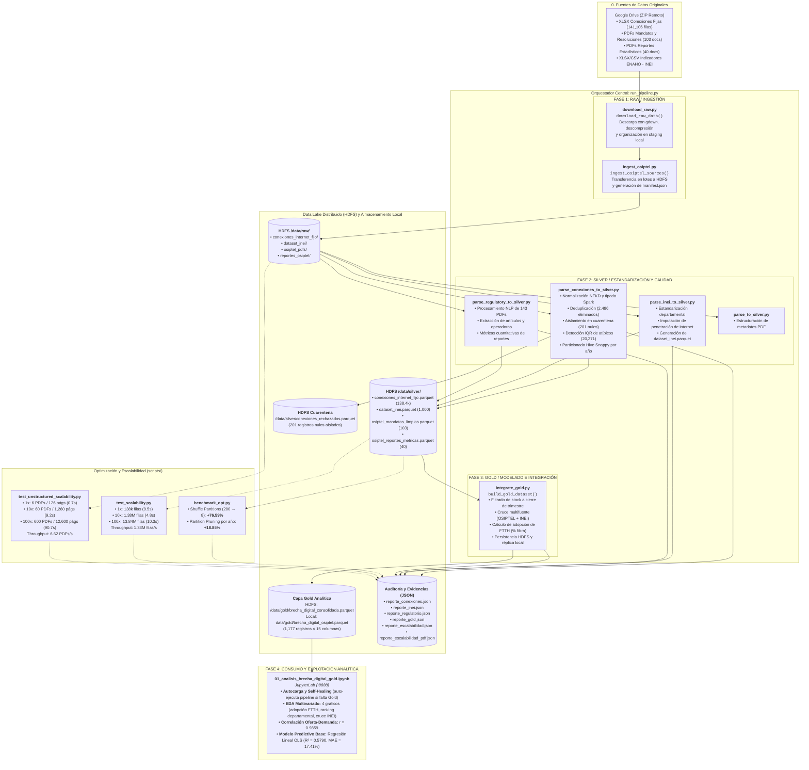

# Pipeline Big Data: Análisis de la Brecha Digital (OSIPTEL & INEI)

Pipeline batch distribuido de Big Data para la ingesta, limpieza, integración analítica y modelado predictivo de la penetración de internet fijo, resoluciones regulatorias de OSIPTEL e indicadores socioeconómicos del INEI (ENAHO). Desarrollado e implementado sobre Hadoop HDFS, Apache Spark (PySpark en clúster YARN) y JupyterLab.

---

## 👥 Equipo del Proyecto

| Integrante | Rol |
|---|---|
| **Sinacay Nuñez, Benjamin** | Coordinación |
| **Casanova Chumpitaz, Angel Francisco** | Análisis y modelado |
| **León García, Axel Erico** | Análisis y modelado |
| **Carruitero Ortiz, Soraya Del Pilar** | Calidad y documentación |
| **Medina Sixce, Darli Manuel** | Ingeniería de datos |

---

## 🏗️ Arquitectura y Diagrama del Pipeline

El siguiente diagrama detalla la arquitectura completa de extremo a extremo: fuentes multiformato, orquestación secuencial e idempotente, almacenamiento distribuido en el Data Lake (HDFS) organizado por capas (Raw, Silver, Gold), auditoría de evidencias, benchmarks de rendimiento/escalabilidad y explotación analítica con modelo predictivo base.



---

## ⚙️ Módulos del Pipeline y Funcionalidad por Archivo

El script [`run_pipeline.py`](file:///Users/dmedinasix/Desktop/bigdata-osiptel-brecha-digital/run_pipeline.py) opera como el **orquestador central** del proyecto. Ejecuta de forma determinista, modular e idempotente las 3 fases del procesamiento distribuido:

### 1. Ingesta y Staging (Fase Raw)
* **[`src/ingestion/download_raw.py`](file:///Users/dmedinasix/Desktop/bigdata-osiptel-brecha-digital/src/ingestion/download_raw.py) (`download_raw_data`):**
  * Descarga el paquete de fuentes crudas desde Google Drive mediante `gdown`.
  * Descomprime y normaliza en el staging local (`data/raw/datos/`), depurando metadatos de macOS (`__MACOSX`, `.DS_Store`).
  * Implementa control de persistencia idempotente (omite descarga si ya existen los datos).
* **[`src/ingestion/ingest_osiptel.py`](file:///Users/dmedinasix/Desktop/bigdata-osiptel-brecha-digital/src/ingestion/ingest_osiptel.py) (`ingest_osiptel_sources`):**
  * Transfiere en lotes los 4 datasets originales hacia HDFS (`/data/raw/conexiones_internet_fijo/`, `/data/raw/dataset_inei/`, `/data/raw/osiptel_pdfs/`, `/data/raw/reportes_osiptel/`).
  * Genera el catálogo de auditoría [`data/manifest.json`](file:///Users/dmedinasix/Desktop/bigdata-osiptel-brecha-digital/data/manifest.json) con hashes MD5 y conteo de archivos.

### 2. Procesamiento, Limpieza y Calidad (Fase Silver)
* **[`src/processing/parse_conexiones_to_silver.py`](file:///Users/dmedinasix/Desktop/bigdata-osiptel-brecha-digital/src/processing/parse_conexiones_to_silver.py) (`process_conexiones_silver`):**
  * Procesa el dataset principal de internet fijo (141,106 registros crudos).
  * **Control de Calidad y Cuarentena:** Detecta registros sin departamento y aísla exactamente 201 filas anómalas en `/data/silver/conexiones_rechazados.parquet`.
  * **Normalización Textual:** Estandariza con NFKD (eliminación de tildes y diacríticos) y mapeo canónico de tecnologías y empresas operadoras.
  * **Deduplicación:** Elimina 2,486 registros duplicados exactos.
  * **Detección de Atípicos (IQR):** Identifica 20,271 registros con volúmenes extremos por operadora y tecnología, marcándolos con `es_atipico = True` sin destruir información.
  * **Particionado Hive:** Guarda 138,419 filas en HDFS particionadas por año (`partitionBy("anio")`) con compresión Snappy y exporta [`evidence/reporte_conexiones.json`](file:///Users/dmedinasix/Desktop/bigdata-osiptel-brecha-digital/evidence/reporte_conexiones.json).
* **[`src/processing/parse_inei_to_silver.py`](file:///Users/dmedinasix/Desktop/bigdata-osiptel-brecha-digital/src/processing/parse_inei_to_silver.py) (`process_inei_silver`):**
  * Limpia la serie histórica de indicadores socioeconómicos ENAHO del INEI.
  * Estandariza la llave de cruce `(anio, trimestre, departamento)` y genera `/data/silver/dataset_inei.parquet`.
* **[`src/processing/parse_regulatory_to_silver.py`](file:///Users/dmedinasix/Desktop/bigdata-osiptel-brecha-digital/src/processing/parse_regulatory_to_silver.py) (`process_regulatory_silver`):**
  * Extrae texto y metadatos de los 143 documentos PDF regulatorios (mandatos, resoluciones y reportes trimestrales).
  * Estructura las tablas `/data/silver/osiptel_mandatos_limpios.parquet` y `/data/silver/osiptel_reportes_metricas.parquet`.
* **[`src/processing/parse_to_silver.py`](file:///Users/dmedinasix/Desktop/bigdata-osiptel-brecha-digital/src/processing/parse_to_silver.py) (`process_general_silver`):**
  * Módulo distribuido en clúster YARN para metadatos generales y textos limpios.

### 3. Modelado e Integración Analítica (Fase Gold)
* **[`src/processing/integrate_gold.py`](file:///Users/dmedinasix/Desktop/bigdata-osiptel-brecha-digital/src/processing/integrate_gold.py) (`build_gold_dataset`):**
  * **Tratamiento Stock vs. Flujo:** Filtra exclusivamente los meses de cierre de trimestre (marzo, junio, septiembre, diciembre) para no triplicar abonados de telecomunicaciones.
  * **Cruce Multifuente (4 fuentes):** Une conexiones limpias con indicadores del INEI, mandatos regulatorios de OSIPTEL y reportes de mercado.
  * **Feature Engineering:** Calcula `pct_fibra_optica`, `total_operadoras_activas` y asigna etiquetas de integridad (`CONSOLIDADO_OSIPTEL_INEI`).
  * **Persistencia:** Almacena la Capa Gold en HDFS (`/data/gold/brecha_digital_consolidada.parquet`) y genera la copia local [`data/gold/brecha_digital_osiptel.parquet`](file:///Users/dmedinasix/Desktop/bigdata-osiptel-brecha-digital/data/gold/) (1,177 filas $\times$ 15 columnas).

### 4. Scripts de Rendimiento y Escalabilidad (`scripts/`)
* **[`scripts/benchmark_opt.py`](file:///Users/dmedinasix/Desktop/bigdata-osiptel-brecha-digital/scripts/benchmark_opt.py):**
  * Compara experimentalmente configuraciones en Spark: `spark.sql.shuffle.partitions` (200 particiones vs. 8 ajustadas al clúster) y `Partition Pruning` de lectura directa de partición vs. escaneo completo.
* **[`scripts/test_scalability.py`](file:///Users/dmedinasix/Desktop/bigdata-osiptel-brecha-digital/scripts/test_scalability.py):**
  * Prueba formal de escalabilidad sobre réplicas estructuradas 1x (138k), 10x (1.38M) y 100x (13.84M filas).
* **[`scripts/test_unstructured_scalability.py`](file:///Users/dmedinasix/Desktop/bigdata-osiptel-brecha-digital/scripts/test_unstructured_scalability.py):**
  * Prueba de escalabilidad no estructurada con muestra representativa balanceada de 2 PDFs por dataset (6 PDFs base) escalando a 1x (6), 10x (60) y 100x (600 PDFs).

### 5. Consumo Analítico y Modelo Predictivo (`notebooks/`)
* **[`notebooks/01_analisis_brecha_digital_gold.ipynb`](file:///Users/dmedinasix/Desktop/bigdata-osiptel-brecha-digital/notebooks/01_analisis_brecha_digital_gold.ipynb):**
  * **Autocarga y Self-Healing:** Detección de `ROOT_DIR` dinámico; si falta el archivo Gold, dispara automáticamente el pipeline completo.
  * **EDA de 4 Preguntas Clave:** Transición tecnológica de fibra, ranking departamental de brecha digital, impacto de la competencia regional y convergencia con hogares del INEI.
  * **Modelo Predictivo Base:** Regresión lineal multivariada para la adopción de fibra óptica ($R^2 = 0.5790$, $\text{MAE} = 17.41\%$).

---

## 📊 Matriz de Capas del Data Lake

| Capa | Ruta en HDFS / Local | Formato | Particionamiento | Registros / Tamaño | Rol en la Arquitectura |
| :--- | :--- | :---: | :---: | :---: | :--- |
| **Raw** | `hdfs:///data/raw/conexiones_internet_fijo/` | XLSX | Directorio | 141,106 filas | Ingesta cruda inmutable de abonados OSIPTEL. |
| **Raw** | `hdfs:///data/raw/osiptel_pdfs/` | PDF | Directorio | 103 archivos | Mandatos y resoluciones regulatorias originales. |
| **Raw** | `hdfs:///data/raw/reportes_osiptel/` | PDF | Directorio | 40 archivos | Reportes de mercado y estadísticas semestrales. |
| **Raw** | `hdfs:///data/raw/dataset_inei/` | XLSX/CSV | Directorio | Series 2015-2024 | Indicadores ENAHO sobre hogares con internet. |
| **Silver** | `hdfs:///data/silver/conexiones_internet_fijo.parquet` | Parquet Snappy | `anio` (Hive) | 138,419 filas | Conexiones limpias, tipadas y sin duplicados. |
| **Silver** | `hdfs:///data/silver/conexiones_rechazados.parquet` | Parquet Snappy | Ninguno | 201 filas | **Cuarentena:** Registros con departamento nulo. |
| **Silver** | `hdfs:///data/silver/dataset_inei.parquet` | Parquet Snappy | `anio` | 1,000 filas | Serie trimestral ENAHO departamental estandarizada. |
| **Silver** | `hdfs:///data/silver/osiptel_mandatos_limpios.parquet` | Parquet Snappy | Ninguno | 103 documentos | Metadatos y artículos procesados de mandatos. |
| **Silver** | `hdfs:///data/silver/osiptel_reportes_metricas.parquet` | Parquet Snappy | Ninguno | 40 reportes | Métricas cuantitativas y resúmenes de mercado. |
| **Gold** | `hdfs:///data/gold/brecha_digital_consolidada.parquet`<br>`data/gold/brecha_digital_osiptel.parquet` | Parquet Snappy | `anio` (Hive) | 1,177 registros $\times$ 15 cols | **Capa Analítica Consolidada:** Cruce final multifuente. |

---

## ⚡ Resultados Empíricos de Rendimiento y Escalabilidad

Mediciones reales ejecutadas directamente sobre el clúster en la Máquina Virtual Debian:

### 1. Optimizaciones en Apache Spark ([`benchmark_opt.py`](file:///Users/dmedinasix/Desktop/bigdata-osiptel-brecha-digital/scripts/benchmark_opt.py))
* **Shuffle Partitions (200 $\rightarrow$ 8 particiones):** Reducción de tiempo de **2.771 s** a **0.649 s** $\rightarrow$ **+76.59% de aceleración** al eliminar sobrecarga de planificación y contención de hilos.
* **Partition Pruning (Lectura Hive particionada por `anio`):** Reducción de tiempo de **0.764 s** a **0.620 s** $\rightarrow$ **+18.85% de mejora** al leer únicamente la partición requerida sin escanear la tabla completa.

### 2. Prueba de Escalabilidad Estructurada ([`reporte_escalabilidad.json`](file:///Users/dmedinasix/Desktop/bigdata-osiptel-brecha-digital/evidence/reporte_escalabilidad.json))
| Factor | Registros Evaluados | Tiempo de Procesamiento | Throughput | Comportamiento |
| :---: | :---: | :---: | :---: | :--- |
| **1x** | 138,419 filas | 9.55 s | 14,494 filas/s | Calentamiento JVM y Catalyst Optimizer. |
| **10x** | 1,384,190 filas | 4.80 s | 288,373 filas/s | Procesamiento en memoria distribuida. |
| **100x** | **13,841,900 filas** | **10.35 s** | **1,337,121 filas/s** | **Escalabilidad cuasi-lineal** de alto rendimiento en Spark. |

### 3. Prueba de Escalabilidad No Estructurada ([`reporte_escalabilidad_pdf.json`](file:///Users/dmedinasix/Desktop/bigdata-osiptel-brecha-digital/evidence/reporte_escalabilidad_pdf.json))
| Factor | Documentos PDF | Páginas Procesadas | Tiempo de Extracción | Throughput |
| :---: | :---: | :---: | :---: | :---: |
| **1x** | 6 PDFs base | 126 páginas | 0.70 s | 8.57 PDFs/s |
| **10x** | 60 PDFs | 1,260 páginas | 9.25 s | 6.49 PDFs/s |
| **100x** | **600 PDFs** | **12,600 páginas** | **90.68 s** | **6.62 PDFs/s** |

---

## 📈 Resultados del Modelo Predictivo Base (Baseline Model)

Entrenado en la Celda 7 del notebook [`notebooks/01_analisis_brecha_digital_gold.ipynb`](file:///Users/dmedinasix/Desktop/bigdata-osiptel-brecha-digital/notebooks/01_analisis_brecha_digital_gold.ipynb) bajo partición 80% Train / 20% Test:

* **Variable Objetivo ($y$):** Tasa departamental de adopción de fibra óptica (`pct_fibra_optica`).
* **Variables Predictoras ($X$):** `anio_num`, `trimestre`, `total_operadoras_activas`, `total_conexiones`.
* **Métricas de Evaluación:**
  * **$R^2$ (Coeficiente de Determinación):** **0.5790** (57.90% de la varianza explicada).
  * **MAE (Error Absoluto Medio):** **17.41%**.
  * **RMSE (Raíz del Error Cuadrático Medio):** **20.81%**.
* **Hallazgo Clave:** Cada operadora activa adicional en el departamento incrementa la penetración de fibra óptica en **+0.93 puntos porcentuales**, comprobando el rol procompetitivo de la regulación de OSIPTEL.
* **Hoja de Ruta para Unidad 2:** Migración a **Spark ML Pipelines** distribuidos con algoritmos no lineales (**Random Forest Regressor** y **Gradient-Boosted Trees**).

---

## 🚀 Guía Rápida de Ejecución

Sigue estos pasos dentro del entorno virtual en la máquina virtual Debian:

### 1. Activar entorno virtual
```bash
source ~/venv-bd/bin/activate
pip install -r requirements.txt
```

### 2. Iniciar servicios del clúster Hadoop
```bash
start-dfs.sh
start-yarn.sh
jps  # Debe listar: NameNode, DataNode, ResourceManager, NodeManager
```

### 3. Ejecutar el Pipeline de Datos
```bash
# Modo idempotente (utiliza persistencia previa)
python run_pipeline.py

# Modo forzado (reprocesamiento total de todas las capas)
python run_pipeline.py --force
```

### 4. Ejecutar Benchmarks de Optimización y Escalabilidad
```bash
# Optimización de Shuffle y Partition Pruning
python scripts/benchmark_opt.py

# Escalabilidad estructurada (hasta 13.8M filas)
python scripts/test_scalability.py

# Escalabilidad no estructurada (hasta 600 PDFs)
python scripts/test_unstructured_scalability.py
```

### 5. Iniciar JupyterLab y Explorar el Notebook
```bash
jupyter lab --ip=0.0.0.0 --port=8888 --no-browser
```
Abre en tu navegador `http://localhost:8888` y ejecuta el notebook:
[`notebooks/01_analisis_brecha_digital_gold.ipynb`](file:///Users/dmedinasix/Desktop/bigdata-osiptel-brecha-digital/notebooks/01_analisis_brecha_digital_gold.ipynb). Cuenta con **autocarga y self-healing garantizados**.
