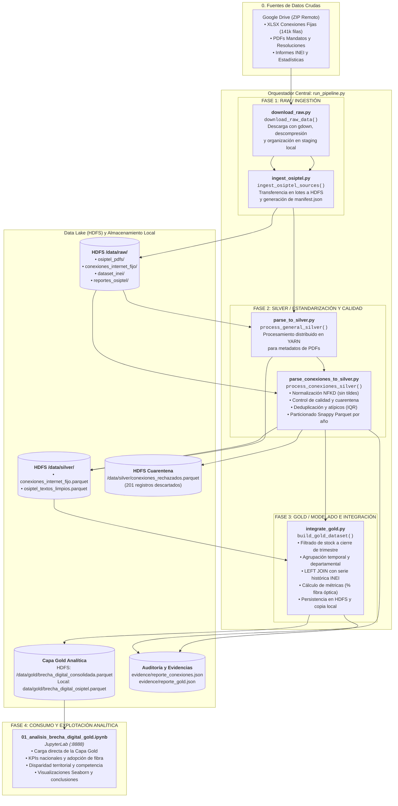

# Pipeline Big Data: Análisis de la Brecha Digital (OSIPTEL & INEI)

Pipeline batch distribuido de Big Data para la ingesta, limpieza, integración y análisis de la penetración de internet fijo y documentos regulatorios de OSIPTEL e indicadores del INEI, implementado sobre HDFS, PySpark en clúster YARN y JupyterLab.

---

## 👥 Equipo del Proyecto

| Integrante | Rol |
|---|---|
| **Sinacay Nuñez, Benjamin** | Coordinación |
| **Casanova Chumpitaz, Angel Francisco** | Análisis y modelado |
| **León García, Axel Erico** | Análisis y modelado |
| **Carruitero Ortiz, Soraya Del Pilar** | Calidad y documentación |
| **Medina Sixce, Darli Manuel** | Ingeniería de datos |

---

## 🏗️ Arquitectura y Diagrama del Pipeline

El siguiente diagrama detalla el flujo de datos de extremo a extremo, desde la descarga inicial hasta el consumo analítico en JupyterLab, destacando cómo el orquestador principal (`run_pipeline.py`) coordina secuencialmente cada módulo de procesamiento distribuido:



---

## ⚙️ ¿Cómo Funciona el Pipeline y Qué Hace Cada Archivo?

El archivo [`run_pipeline.py`](file:///Users/dmedinasix/Desktop/bigdata-osiptel-brecha-digital/run_pipeline.py) actúa como el **orquestador central** del proyecto. Se encarga de ejecutar de forma ordenada, determinista e idempotente las 3 fases del procesamiento de datos llamando a los módulos ubicados en `src/`:

### 1. Ingesta (Fase Raw)
* **[`src/ingestion/download_raw.py`](file:///Users/dmedinasix/Desktop/bigdata-osiptel-brecha-digital/src/ingestion/download_raw.py) (`download_raw_data`):**
  * Descarga el archivo comprimido desde Google Drive con `gdown`.
  * Descomprime y estructura los archivos en el staging local (`data/raw/datos/`), eliminando metadatos temporales de macOS (`__MACOSX`, `.DS_Store`).
  * Implementa control de persistencia para no re-descargar si los datos ya existen localmente.
* **[`src/ingestion/ingest_osiptel.py`](file:///Users/dmedinasix/Desktop/bigdata-osiptel-brecha-digital/src/ingestion/ingest_osiptel.py) (`ingest_osiptel_sources`):**
  * Sube los 4 datasets a sus respectivos directorios del Data Lake en HDFS (`/data/raw/osiptel_pdfs/`, `/data/raw/conexiones_internet_fijo/`, `/data/raw/dataset_inei/`, `/data/raw/reportes_osiptel/`).
  * Genera el catálogo de auditoría [`data/manifest.json`](file:///Users/dmedinasix/Desktop/bigdata-osiptel-brecha-digital/data/manifest.json) con el hash y conteo de archivos.

### 2. Procesamiento y Limpieza (Fase Silver)
* **[`src/processing/parse_to_silver.py`](file:///Users/dmedinasix/Desktop/bigdata-osiptel-brecha-digital/src/processing/parse_to_silver.py) (`process_general_silver`):**
  * Inicializa PySpark sobre el clúster YARN para procesar los documentos regulatorios en formato binario (`binaryFile`).
  * Estructura los metadatos de los PDFs y los guarda en `hdfs://localhost:9000/data/silver/osiptel_textos_limpios.parquet`.
* **[`src/processing/parse_conexiones_to_silver.py`](file:///Users/dmedinasix/Desktop/bigdata-osiptel-brecha-digital/src/processing/parse_conexiones_to_silver.py) (`process_conexiones_silver`):**
  * Lee el dataset principal de internet fijo (141,106 filas).
  * **Control de calidad y cuarentena:** Detecta nulos en columnas obligatorias (`Mes`, `Empresa`, `Departamento`, `Conexiones`) y aísla 201 registros defectuosos en `/data/silver/conexiones_rechazados.parquet`.
  * **Estandarización textual:** Normaliza diacríticos (sin tildes con NFKD) y desdobla categorías y códigos mediante expresiones regulares.
  * **Deduplicación:** Elimina 2,486 filas duplicadas exactas.
  * **Atípicos:** Detecta y marca 20,271 registros con la bandera `es_atipico = True` mediante Rango Intercuartílico (IQR) segmentado por empresa y tecnología.
  * **Persistencia columnar:** Guarda la tabla limpia en HDFS particionada por año (`partitionBy("anio")`) comprimida con Snappy y genera el reporte dinámico [`evidence/reporte_conexiones.json`](file:///Users/dmedinasix/Desktop/bigdata-osiptel-brecha-digital/evidence/reporte_conexiones.json).

### 3. Modelado e Integración Analítica (Fase Gold)
* **[`src/processing/integrate_gold.py`](file:///Users/dmedinasix/Desktop/bigdata-osiptel-brecha-digital/src/processing/integrate_gold.py) (`build_gold_dataset`):**
  * **Tratamiento Stock vs Flujo:** Filtra exclusivamente los meses de cierre de trimestre (Marzo, Junio, Septiembre, Diciembre) para no triplicar abonados.
  * **Agregaciones:** Sumariza conexiones totales, adopción de fibra óptica y cablemódem, y calcula el ratio `pct_fibra_optica`.
  * **Cruce Interinstitucional:** Realiza un `LEFT JOIN` con la serie histórica del INEI bajo la clave compuesta `(anio, trimestre, departamento)`, asignando la etiqueta `estado_integracion = 'CONSOLIDADO'` o `'SIN_DATO_INEI'`.
  * **Persistencia:** Guarda la capa Gold consolidada en HDFS (`/data/gold/brecha_digital_consolidada.parquet`) y exporta una copia local a [`data/gold/brecha_digital_osiptel.parquet`](file:///Users/dmedinasix/Desktop/bigdata-osiptel-brecha-digital/data/gold/) para el consumo de analistas.

### 4. Consumo y Visualización
* **[`notebooks/01_analisis_brecha_digital_gold.ipynb`](file:///Users/dmedinasix/Desktop/bigdata-osiptel-brecha-digital/notebooks/01_analisis_brecha_digital_gold.ipynb):**
  * Diseñado exclusivamente para el equipo de análisis y modelado.
  * No realiza ingestas ni limpiezas: carga directamente la Capa Gold y genera consultas SQL/Pandas, gráficos con Seaborn y hallazgos regulatorios para OSIPTEL.

---

## 📊 Matriz de Capas del Data Lake

| Capa | Ubicación | Formato / Compresión | Particionamiento | Registros | Propósito |
| :--- | :--- | :---: | :---: | :---: | :--- |
| **Raw** | `hdfs:///data/raw/` | Binario / XLSX / PDF | Por carpeta dataset | 4 datasets | Almacenamiento inmutable de fuentes originales. |
| **Silver** | `hdfs:///data/silver/conexiones_internet_fijo.parquet` | Parquet (Snappy) | `anio` | 138,419 | Conexiones limpias, validadas y tipadas. |
| **Silver (Cuarentena)** | `hdfs:///data/silver/conexiones_rechazados.parquet` | Parquet (Snappy) | Sin partición | 201 | Registros con nulos críticos para auditoría. |
| **Silver (PDFs)** | `hdfs:///data/silver/osiptel_textos_limpios.parquet` | Parquet (Snappy) | Sin partición | 143 PDFs | Metadatos y control de textos regulatorios. |
| **Gold** | `hdfs:///data/gold/brecha_digital_consolidada.parquet`<br>`data/gold/brecha_digital_osiptel.parquet` | Parquet (Snappy) | `anio` | Trimestral agregado | Dataset analítico consolidado (OSIPTEL + INEI). |

---

## 🚀 Guía Rápida de Ejecución

Sigue estos pasos en tu terminal dentro de la máquina virtual Debian:

### 1. Activar entorno virtual e instalar dependencias
```bash
source ~/venv-bd/bin/activate
pip install -r requirements.txt
```

### 2. Iniciar servicios distribuidos (Hadoop HDFS y YARN)
```bash
start-dfs.sh
start-yarn.sh
jps  # Debe mostrar NameNode, DataNode, ResourceManager, NodeManager
```

### 3. Ejecutar el Orquestador General
```bash
# Ejecución estándar (idempotente)
python run_pipeline.py

# O forzar reprocesamiento completo ignorando persistencia previa:
python run_pipeline.py --force
```

### 4. Iniciar JupyterLab para Exploración Analítica
```bash
jupyter lab --ip=0.0.0.0 --port=8888 --no-browser
```
Abre el notebook [`notebooks/01_analisis_brecha_digital_gold.ipynb`](file:///Users/dmedinasix/Desktop/bigdata-osiptel-brecha-digital/notebooks/01_analisis_brecha_digital_gold.ipynb) para visualizar las métricas y gráficos de la brecha digital.